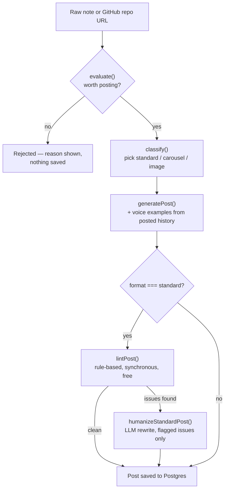
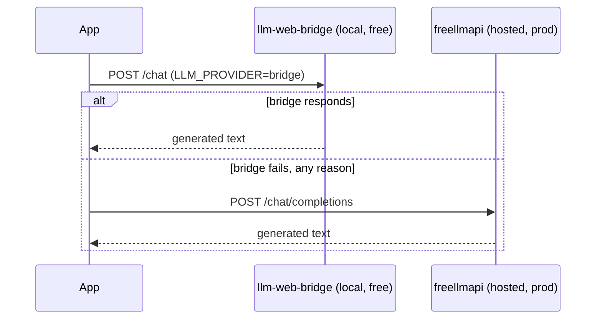

<div align="center">
  <h1>
    Pulse <sup><sub>v1.0.0</sub></sup>
  </h1>
  <p>
    <em>Turns a raw technical note into a polished, on-brand LinkedIn post in 30 seconds.</em>
  </p>
  <br />

  
  
  
  
  
  

  [](https://pulse-linkedin.onrender.com)
</div>

---

Writing LinkedIn posts is not the hard part of shipping something — the shipping is. The writing gets skipped, or it gets outsourced to a template that reads like every other tech-influencer post, or it takes an hour of staring at a blank composer for something that should take five minutes. Pulse takes the note you already wrote for yourself — a Slack message, a half-formed bullet point, a commit message — and turns it into a post that sounds like you, not like a template.

It runs a three-stage pipeline against your actual profile and your actual posting history: it decides whether the idea is worth posting at all, picks the right format for it, and writes the draft. A rule-based linter checks the output for AI-writing tells before an LLM rewrite pass ever gets invoked, so the extra generation call only happens when something's actually wrong. Nothing posts itself — every draft lands in a backlog for you to read, edit, and paste into LinkedIn by hand.

The interesting engineering decision here isn't the LLM call — it's everywhere around it. Free-tier constraints (a single Postgres instance, a free Render dyno, a zero-cost LLM proxy) forced real tradeoffs: a rule-based linter instead of a second unconditional LLM pass, a hostname-allowlist-plus-redirect-revalidation instead of trusting `fetch`'s default redirect handling, a scrypt-derived signing key instead of the raw password. None of it is exotic. All of it was a deliberate choice against a cheaper, more obviously wrong alternative.

## Features

**Evaluate → classify → generate pipeline** — scores whether a raw idea is specific enough to be worth a post, picks standard/carousel/image format, then writes the full draft in one LLM call chain.

**Style learning from real posted history** — voice examples fed into every generation call are pulled from your 3 most recent *actually posted* posts, not a frozen fixture file. Falls back to two static examples only until you've posted something for real.

**Duplicate-topic detection** — checks a new idea against your last 15 posts and surfaces a soft warning (never a hard block) when it's too close to something recent.

**Humanizer / quality gate** — a synchronous, zero-cost rule-based linter checks every standard-post draft for AI-tell phrases, hashtag count, word count, and em-dash overuse. Only when it flags something does a second LLM call rewrite the flagged parts.

**Repo-to-draft** — paste a GitHub URL instead of typing a note. Pulls the description, README, and recent commit subjects from the public GitHub API and feeds it through the same pipeline as manual input.

**Free engagement auto-fetch** — pulls real like/comment counts from a public LinkedIn post URL with a plain HTTP GET — no login, no API key, no browser automation. LinkedIn server-renders those counts into permalink HTML for logged-out viewers; this reads them directly.

**Dual LLM provider with fallback** — a local browser-driven bridge for free local development, a hosted multi-provider proxy for production, automatic fallback from one to the other on any failure.

**Single-password access gate** — one shared secret, no user accounts, fails closed if misconfigured in production.

## How it works





**Key decisions:**

- **Persistent Node service (Render) over serverless (Vercel)**: the pipeline chains 3+ sequential LLM calls per request — evaluate, classify, generate, and conditionally humanize. Vercel's Hobby-tier function timeout is a real risk for that chain; a long-lived Node process has no such ceiling.
- **Public-HTML engagement scraping over LinkedIn's official API**: LinkedIn's analytics API requires Marketing Developer Platform partner approval, unavailable to a personal account. Empirically confirmed LinkedIn server-renders `data-num-reactions`/`data-num-comments` into permalink HTML for logged-out viewers — a plain `fetch` gets real numbers for free. Every redirect hop is re-validated against the same hostname allowlist rather than trusted via `redirect: 'follow'`, closing an SSRF-via-open-redirect gap the naive version has.
- **Voice examples from the database over static fixture files**: pulling from the 3 most recent posted posts means the model's few-shot examples compound as the archive grows, instead of staying frozen at whatever two examples were written on day one.
- **A scrypt-derived signing key over the raw password for session cookies**: the HMAC that signs the session cookie is keyed off `scrypt(APP_PASSWORD)`, not `APP_PASSWORD` directly — a leaked cookie can't be cheaply brute-forced back into the real password, since scrypt is deliberately slow and HMAC-SHA256 alone is not.
- **A rule-based linter gating the LLM rewrite pass, not an unconditional second call**: `lintPost` is synchronous and costs nothing. The humanizer LLM call only fires when the linter actually finds something wrong, so a clean draft is never billed for a rewrite it doesn't need.

## Tech stack

| Technology | Role | Why |
|---|---|---|
| Next.js 16 (Turbopack) | Frontend + API routes | `middleware.ts` is deprecated in this version in favor of `proxy.ts` — a real breaking change this project hit directly |
| React 19 | UI | — |
| TypeScript 5 (strict) | Language | — |
| Prisma 7 + `@prisma/adapter-pg` | ORM | Direct `pg` driver adapter, not Prisma's default connection handling — matches a long-lived Node process rather than a serverless one |
| PostgreSQL (Neon) | Database | Single free-tier instance; integration tests run against it directly since test cleanup is always scoped to specific created rows |
| Tailwind CSS 4 + Base UI | Styling / components | — |
| Zod | Validation | Schema-level cross-validation between a post's `format` and its `content` shape, not just per-field checks |
| Vitest | Testing | Split into a DB-free unit config and a DB-integration config so unit tests never depend on network/DB availability |
| freellmapi | Hosted LLM proxy (prod) | Zero-cost multi-provider routing with a `bridge`-mode local fallback for development |

## Getting started

### Prerequisites

- Node.js 20+
- A PostgreSQL connection string (a free [Neon](https://neon.tech) project works)

### Clone

```bash
git clone https://github.com/yassine-krichen/pulse-linkedin-post-generator.git
cd pulse-linkedin-post-generator/web
```

### Install

```bash
npm install
```

### Configure

```bash
cp .env.example .env.local
# fill in DATABASE_URL at minimum — see Configuration below
```

### Run (development)

```bash
npx prisma generate
npx prisma migrate deploy
npm run dev
```

App is at http://localhost:3000.

### Run (production)

```bash
npm run build && npm start
```

### Test

```bash
npm run test:unit         # fast, no DB/network dependency
npm run test:integration  # runs against the real configured DATABASE_URL
```

## Configuration

| Variable | Required | Default | Description |
|---|---|---|---|
| `DATABASE_URL` | Yes | — | Postgres connection string |
| `LLM_PROVIDER` | No | `bridge` | `bridge` (local, free, browser-driven) or `freellmapi` (hosted, used in production) |
| `LLM_BRIDGE_URL` | If `LLM_PROVIDER=bridge` | `http://127.0.0.1:3000` | Local `llm-web-bridge` instance (a separate project that drives a logged-in browser session) |
| `LLM_BRIDGE_API_KEY` | No | — | Only if the bridge instance requires one |
| `LLM_BRIDGE_PROVIDER` | No | `claude` | `claude` or `chatgpt` |
| `FREELLM_BASE_URL` | If `LLM_PROVIDER=freellmapi`, or as bridge fallback | — | OpenAI-compatible proxy base URL |
| `FREELLM_API_KEY` | If `LLM_PROVIDER=freellmapi`, or as bridge fallback | — | — |
| `GITHUB_TOKEN` | No | — | Raises the repo-to-draft feature's GitHub API limit from 60/hr to 5000/hr |
| `BRAVE_SEARCH_API_KEY` | No | — | Reserved for a planned trending-topics search feature, not yet wired up |
| `APP_PASSWORD` | Yes in production | — | Shared password gating the whole app. Unset in dev = no gate; unset in production fails closed |

## API

`POST /api/pipeline` — `{ input: string }` or `{ repoUrl: string }`. Runs the full evaluate→classify→generate pipeline, returns the evaluation, classification, and saved post (or a rejection reason if not worth posting).

`POST /api/posts/[id]/regenerate` — `{ tone?: 'default' | 'casual' | 'punchier' | 'technical' }`. Regenerates an existing post's content in a different tone, running the same lint/humanize gate.

`POST /api/posts/[id]/hook-variants` — returns 2 alternative hooks for a standard-format post without touching the rest of the content.

`POST /api/posts/[id]/refresh-engagement` — best-effort fetch of real like/comment counts from the post's stored LinkedIn URL.

`POST /api/demo` — unauthenticated landing-page demo. Streams a generated post, is rate-limited per client IP (3 requests per 10 minutes), rejects bodies over 4 KB and persists nothing.

`GET /api/public-stats` — no authentication required. Aggregate counts only (no post content or titles).

## Roadmap

| Status | Item |
|---|---|
| Done | Evaluate → classify → generate pipeline |
| Done | Style learning from real posted history |
| Done | Duplicate-topic detection |
| Done | Rule-based humanizer / quality gate |
| Done | Repo-to-draft |
| Done | Free engagement auto-fetch |
| Done | Hook variants |
| Done | Public landing-page demo with streamed generation, rate-limited, nothing stored |
| Planned | Multi-platform drafts (X/Twitter, dev.to) — same pipeline, different length/format constraints |
| Planned | Trending-topic search backed by a real search API (the planner page currently asks the LLM for topic ideas) |

## License

**Source-available, not open source.** Pulse is published under the
[PolyForm Strict License 1.0.0](LICENSE): you may read, run, and learn from the code
for personal, research, or evaluation use.

You may **not** use it commercially, redistribute it, rebrand it, or publish modified
versions without written permission. Copyright (c) 2026 Yassine Krichen. All rights
not granted by the license are reserved.

For commercial licensing or collaboration: krichenyassine22@gmail.com

---

Built by [Yassine Krichen](https://github.com/yassine-krichen)
